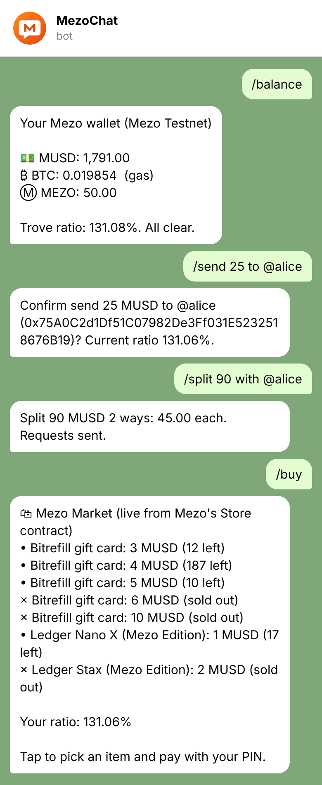
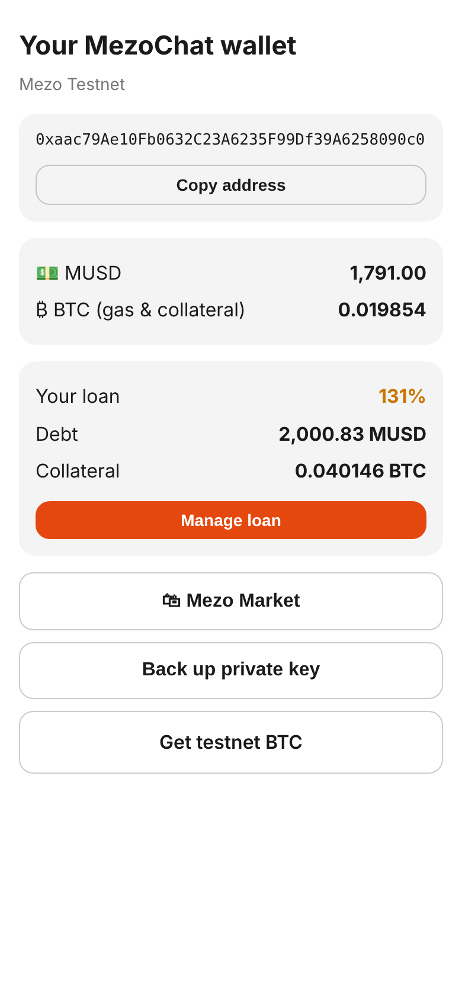
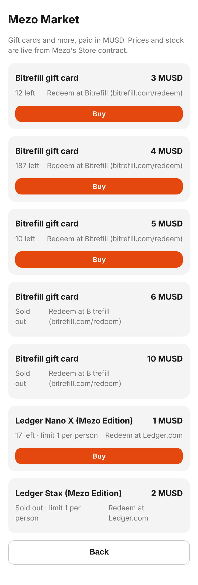
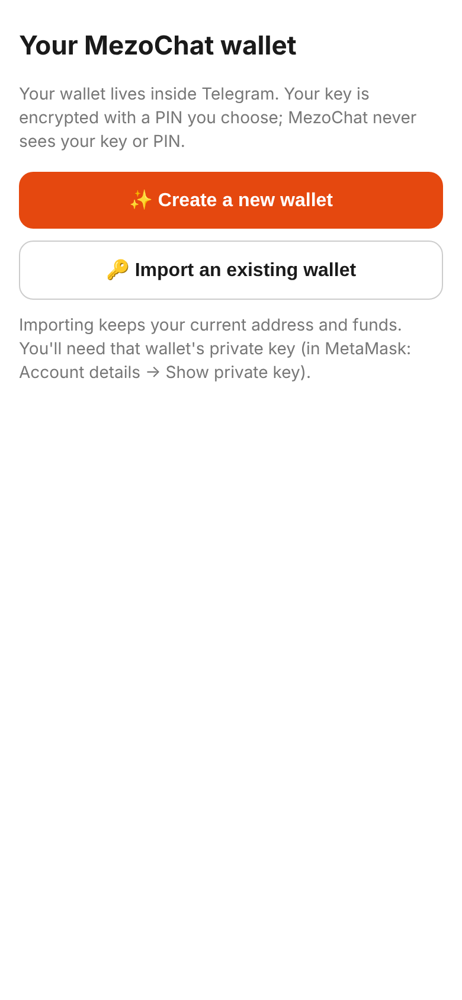
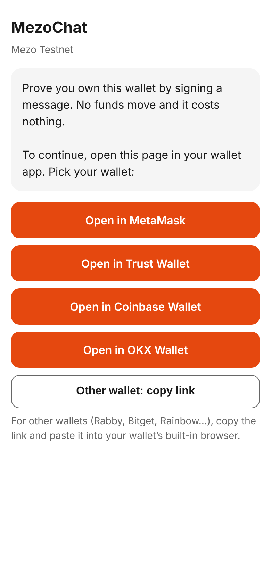
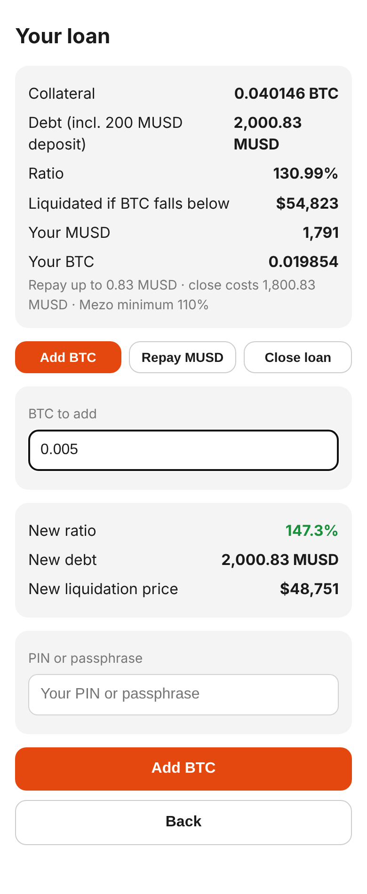
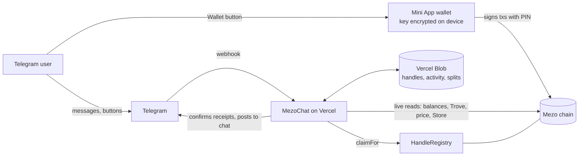

<p align="center">
  
</p>

<h1 align="center">MezoChat</h1>

<p align="center">
  <b>Your MUSD bank, inside Telegram.</b><br>
  Borrow against Bitcoin, send to any @username, split bills, run ratio-protected recurring payments and shop on Mezo Market, all without leaving the chat.
</p>

<p align="center">
  <a href="https://t.me/MezoChat_Bot"><b>▶ Open @MezoChat_Bot</b></a> ·
  <a href="https://pay.mezochat.xyz/health">pay.mezochat.xyz</a> ·
  <a href="https://explorer.test.mezo.org/address/0xd5c172f90799670de5f05b7506f13d977eccc6b5">On-chain handle registry</a>
</p>

<p align="center">
  
  
  
  
  
</p>

<p align="center">
  
  
  
</p>

---

## Why MezoChat

MUSD is Bitcoin-backed money. MezoChat puts the whole everyday money loop where people already talk: **Telegram**.

- **One place.** Check your balance, borrow, pay friends, split a dinner, pay rent on schedule and buy a gift card, all in the same chat.
- **Bitcoin stays safe.** Every spend, payment and recurring transfer checks your live Trove collateral ratio first, using *your* safety level.
- **You own your keys.** Create or import a wallet inside Telegram. It's encrypted on your device with your PIN or passphrase. Prefer MetaMask, Trust, Coinbase or OKX? Connect them instead.
- **Built on Mezo.** It uses Mezo's own contracts (MUSD, TroveManager, BorrowerOperations, PriceFeed, Mezo Store) plus an on-chain @handle registry we deployed on Mezo.

---

## What you can do

### 👛 A wallet that lives in Telegram

Tap **Wallet** in the chat. Create a new wallet or import yours. Your key is encrypted on your device with a PIN or passphrase (PBKDF2, 600,000 rounds, AES-GCM) and stored in your Telegram cloud. MezoChat never sees it.

<p align="center">
  
  
  
</p>

### 🏦 Borrow MUSD against your Bitcoin, right in the chat

`/borrow` opens a live quote straight from Mezo's contracts as you type:
- collateral ratio
- liquidation price
- how far BTC can drop before liquidation
- the BTC you need for Mezo's minimum and for your own safety level
- fee, refundable deposit and total debt

One-tap helpers fill in safe amounts. Before you sign, MezoChat runs the exact transaction against Mezo, then opens your Trove through `BorrowerOperations.openTrove`.

<p align="center">
  
  
</p>

### 🛡️ Manage your loan

`/loan` lets you **add BTC**, **repay MUSD** or **close the loan and get your BTC back**. Each action shows your new ratio and liquidation price before you confirm, and the bot posts a receipt in chat.

### 💸 Pay anyone by @username

`/send 25 to @alice` works with a MezoChat handle, a **Telegram @username** or any 0x address. Confirm, tap **Pay**, enter your PIN, and the bot checks the MUSD transfer on-chain before posting the receipt to you and the recipient.

<p align="center">
  
</p>

### 🧾 Requests and bill splits

- `/request 40 from @bob` sends Bob a **Pay** button.
- `/split 120 with @alice @bob` splits the bill evenly and messages everyone their share.
- `/splits` shows who has paid, with a **Nudge** button for the rest. You get "✓ @bob paid" as shares come in, and "Split fully settled 🎉" at the end.

### 🔁 Ratio-protected recurring payments

`/pay 800 to @landlord on the 1st if ratio > 160` schedules rent that only goes out while your collateral is healthy. `/recurring` lists them, with one-tap cancel.

### 🛍️ Mezo Market inside Telegram

`/buy` shows Mezo Market's catalog, with **prices and stock read live from Mezo's on-chain Store contract**: Bitrefill gift cards and Mezo-edition Ledger wallets. Pick an item and pay with your PIN; MezoChat approves MUSD and calls `order(productId)` on the Store. Before you pay, it checks stock, per-person limits, your MUSD balance and your ratio. Your receipt includes a **Reveal my code** button that opens the item on Mezo Market, where Mezo shows your redemption code.

<p align="center">
  
  
</p>

### 🎁 Instant gift cards, with the code delivered in chat

`/giftcard netflix` searches Bitrefill's live catalog of thousands of brands. Pick a card and an amount, tap **Buy now**, and **the redemption code arrives in the chat within seconds**, through the [Bitrefill API](https://docs.bitrefill.com/docs/api-overview). Each purchase is logged in `/activity` with its Bitrefill order ID. `/giftcard test` runs Bitrefill's demo card end to end.

### 🔔 Safety alerts

MezoChat watches every user's Trove and warns them when their ratio falls below their own safety level (`/alert 160`), and urgently near Mezo's 110% liquidation line. A check runs every 3 hours.

### ⛓️ On-chain @handles

Handles are mirrored to our `HandleRegistry` contract on Mezo, so anyone can verify who a handle pays (`/whois @alice`). Reconnect from any device and your handle is **restored from the chain**. Every handle stays with the wallet that registered it.

### 🤖 Plain-language commands

Type the way you talk: *"yo send bob twenty for lunch"* becomes `send 20 to @bob`. The AI maps messages onto MezoChat's own commands, and every action still goes through confirmation and the safety checks.

### 🚰 Testnet faucet guide

`/faucet` gives your address and one-tap links to Mezo's testnet faucet and the Borrow page.

---

## Proven on-chain

Every core flow has been run end to end through the MezoChat Mini App on **Mezo Testnet**:

| Flow | Transaction |
|---|---|
| Borrow 1,800 MUSD (open Trove) | [`0x1870d4e2…2dd57`](https://explorer.test.mezo.org/tx/0x1870d4e26b05963476d5326f94658c97c19772da6060236aef343ad92d52dd57) |
| Add BTC to the loan | [`0xad676b2f…0eac0f`](https://explorer.test.mezo.org/tx/0xad676b2f0c88c2381c86aec512451e70b7dfdef2be20033dafaae4821a0eac0f) |
| Buy a Bitrefill gift card on Mezo Market (Store order #609) | [`0x15095f35…cf83ec4`](https://explorer.test.mezo.org/tx/0x15095f35288455690aceae7a3e65a3f8816c90f8f2afa0dda8c274bd4cf83ec4) |
| Repay MUSD | [`0x2f2531b2…bf15dc`](https://explorer.test.mezo.org/tx/0x2f2531b2bb17d984fe93f66a3d7f2a865648843d80cf8bc37bf7ea50bfbf15dc) |
| Send 5 MUSD from the in-Telegram wallet | [`0xec41d08e…1c1a2`](https://explorer.test.mezo.org/tx/0xec41d08e7f0044a7a30359e02981381bf0e9e42824286238101519c875a1c1a2) |
| Register a @handle on-chain | [`0xb7804bc4…166e4`](https://explorer.test.mezo.org/tx/0xb7804bc4e2bad02951e37da54cfc6127db9811a8a64678e59654df0cbc8166e4) |

---

## Commands

Type `/` in the chat for the menu, or just write a sentence.

| Command | What it does |
|---|---|
| `/wallet` | Open your MezoChat wallet inside Telegram |
| `/borrow` | Borrow MUSD against BTC, with a live quote |
| `/loan` | Add BTC, repay MUSD or close your loan |
| `/balance` | Your Mezo wallet: MUSD, BTC, MEZO and Trove ratio |
| `/health` | Collateral, debt, BTC price and ratio |
| `/send` | `/send 25 to @alice` or `/send 25 to 0x…` |
| `/request` | `/request 40 from @bob` |
| `/split` | `/split 120 with @alice @bob` |
| `/splits` | Who has paid, with nudges |
| `/pay` | `/pay 800 to @landlord on the 1st if ratio > 160` |
| `/recurring` | List or cancel recurring payments |
| `/buy` | Mezo Market: gift cards and more, paid in MUSD |
| `/giftcard` | `/giftcard netflix`: instant gift card with the code delivered in chat |
| `/activity` | Your recent receipts |
| `/alert` | `/alert 160` sets your safety level |
| `/whois` | `/whois @alice` shows the wallet and on-chain status |
| `/faucet` | Testnet BTC and how to borrow MUSD |
| `/connect` | Link a different wallet |

Every completed action ends with a receipt:

```
✓ Send
Amount: 25 MUSD
To/From: @alice
Ratio at time: 187%
Tx: 0x…
```

---

## How it works



1. **Chat.** Telegram delivers each message to MezoChat's webhook, protected by a secret token. The bot parses commands and plain sentences, with optional AI translation constrained to real commands.
2. **Safety gate.** Before any spend, the bot reads the live Trove ratio (`TroveManager.getCurrentICR` with `PriceFeed.fetchPrice`) and compares it to your threshold.
3. **Signing.** Payments, borrowing and purchases open the Mini App. Your key is decrypted on your device with your PIN and signs the transaction locally. External wallets sign on a page that works with MetaMask, Trust, Coinbase, OKX and any wallet browser.
4. **Confirmation.** The server waits for the receipt, checks the MUSD `Transfer` log matches the amount and recipient, then posts the receipt in chat.
5. **Identity.** Telegram's signed `initData` is verified on every Mini App request, and wallets are linked by signature.

### Mezo contracts used (testnet, chain 31611)

| Contract | Address |
|---|---|
| MUSD | `0x118917a40FAF1CD7a13dB0Ef56C86De7973Ac503` |
| TroveManager | `0xE47c80e8c23f6B4A1aE41c34837a0599D5D16bb0` |
| BorrowerOperations | `0xCdF7028ceAB81fA0C6971208e83fa7872994beE5` |
| PriceFeed | `0x86bCF0841622a5dAC14A313a15f96A95421b9366` |
| HintHelpers | `0x4e4cBA3779d56386ED43631b4dCD6d8EacEcBCF6` |
| SortedTroves | `0x722E4D24FD6Ff8b0AC679450F3D91294607268fA` |
| Mezo Store (Market) | `0xBaeB52D7f812b7C2D109aAe7e50d1BabF2759fcE` |
| **HandleRegistry** (MezoChat) | [`0xd5c172f90799670de5f05b7506f13d977eccc6b5`](https://explorer.test.mezo.org/address/0xd5c172f90799670de5f05b7506f13d977eccc6b5) |

Mainnet addresses (chain 31612) are in [`src/config.ts`](src/config.ts) and [`src/mezo/market.ts`](src/mezo/market.ts). This includes the **Mezo Store on mainnet, `0xb6881e8b21a3cd6d23c4f90724e26e35bb8980be`**, which MezoChat located from its `OrderPlaced` events (see [`scripts/find-store.ts`](scripts/find-store.ts)). Its live catalog has Bitrefill gift cards at 25, 50, 100, 200 and 1,000 MUSD, plus the Mezo-edition Ledger Nano X and Stax. Switch networks with `MEZO_NETWORK=mainnet`.

### HandleRegistry

[`contracts/HandleRegistry.sol`](contracts/HandleRegistry.sol) maps lowercase @handles to wallets.
- Users can `claim` a handle directly.
- After a user proves wallet ownership by signature, MezoChat's relayer calls `claimFor`.
- An existing handle can only ever be claimed by its own wallet.

---

## Security

- **Non-custodial:** keys are generated and encrypted in the Mini App (PBKDF2 600k + AES-GCM) and kept in Telegram CloudStorage, with a device copy. The server never receives a key or PIN.
- **Verified identity:** Telegram `initData` is checked by HMAC on every Mini App call, and wallets are linked with signed messages.
- **Single-use links:** signing links expire after 30 minutes and can only be used once.
- **Payment checks:** payments must come from the linked wallet. Receipts are only posted after the on-chain `Transfer` log matches.
- **Pre-flight dry runs:** borrow, loan and market transactions are run against Mezo's contracts before you sign.
- **Webhook protection:** Telegram's webhook requires a secret token, and the scheduled safety check rate-limits itself.
- **Concurrency-safe storage:** data lives in private Vercel Blob storage with conditional (ETag) writes and automatic merging.

---

## Tech stack

| Area | Built with |
|---|---|
| Bot | TypeScript, [grammY](https://grammy.dev), Telegram webhook + Mini App |
| Chain | [viem](https://viem.sh), Mezo RPC, Mezo MUSD contracts |
| Wallet | Web Crypto (PBKDF2 / AES-GCM), Telegram CloudStorage |
| AI | OpenAI (`gpt-4o-mini`), constrained to MezoChat commands |
| Gift cards | Bitrefill API (codes delivered in chat) and the Mezo Store contract |
| Contract | Solidity 0.8.24 (`HandleRegistry`) |
| Hosting | Vercel Functions (Build Output API), Vercel Blob, Vercel Cron + GitHub Actions |

### Project structure

```
src/
  bot/         Telegram handlers, slash menu, onboarding, scheduler
  agent/       command parser, safety gate, AI translator
  commands/    order handlers (balance, send, split, recurring, market…)
  mezo/        chain client, borrow quotes, loan actions, Mezo Market, registry
  mini/        the in-Telegram wallet (Mini App)
  web/         HTTP API, signer page, Telegram initData verification
  registry/    storage (file locally, Vercel Blob in production)
  vercel.ts    Vercel function entry (webhook, cron, API)
contracts/     HandleRegistry.sol + compiled ABI
scripts/       build, deploy, real end-to-end testnet checks
docs/images/   screenshots
```

Product docs: [PRODUCT.md](PRODUCT.md) · [ARCHITECTURE.md](ARCHITECTURE.md) · [ORDERS.md](ORDERS.md) · [AGENTIC_PROMPT.md](AGENTIC_PROMPT.md) · [RESOURCES.md](RESOURCES.md)

---

## Run it yourself

**Requirements:** Node.js 20+ and a bot token from [@BotFather](https://t.me/BotFather).

```bash
npm install
TELEGRAM_BOT_TOKEN=... npm start         # long-polling bot + web server on :3000
npm test                                  # unit tests
npm run vercel-build                      # Vercel build output in .vercel/output
```

| Variable | Purpose |
|---|---|
| `TELEGRAM_BOT_TOKEN` | Bot token from @BotFather |
| `MEZO_NETWORK` | `testnet` (default) or `mainnet` |
| `PUBLIC_URL` | Public https URL. Turns on the Mini App wallet and in-chat signing. |
| `OPENAI_API_KEY` | Turns on plain-language understanding |
| `BITREFILL_API_KEY` / `BITREFILL_OWNER_HANDLE` / `BITREFILL_DAILY_USD` | Instant gift cards with codes in chat, plus who can use them and the daily budget |
| `REGISTRY_ADDRESS` / `PRIVATE_KEY` | On-chain handle registry and its relayer (deploy with `scripts/deploy-registry.ts`) |
| `TELEGRAM_WEBHOOK_SECRET` / `CRON_SECRET` | Webhook and one-time setup secrets on Vercel |
| `BLOB_READ_WRITE_TOKEN` | Vercel Blob storage, set automatically when the store is connected |

**Deploy to Vercel:** connect the repo, set the build command to `npm run vercel-build`, add the variables above, then call `POST /api/setup` once with `Authorization: Bearer $CRON_SECRET` to register the Telegram webhook and menu.

### Real end-to-end checks

```bash
E2E_KEY=0x… npx tsx scripts/real-e2e.ts out      # borrow → add BTC → Mezo Market purchase → repay
E2E_KEY=0x… npx tsx scripts/real-pay-e2e.ts 0x… 5 # in-Telegram MUSD payment
npx tsx scripts/market-quote-check.ts              # live Mezo Market catalog
E2E_KEY=0x… npx tsx scripts/readme-shots.ts        # regenerate these screenshots
```

---

## Roadmap

- **Gift card codes delivered straight into the chat**, together with the Mezo team
- **Mainnet launch** on Mezo with the production Store and MUSD contracts
- **Handle transfer** when a user moves to a new wallet
- **Group chats:** split and settle bills directly in group conversations

---

<p align="center"><b>MezoChat</b>: Bitcoin-backed money, as easy as sending a message.</p>
