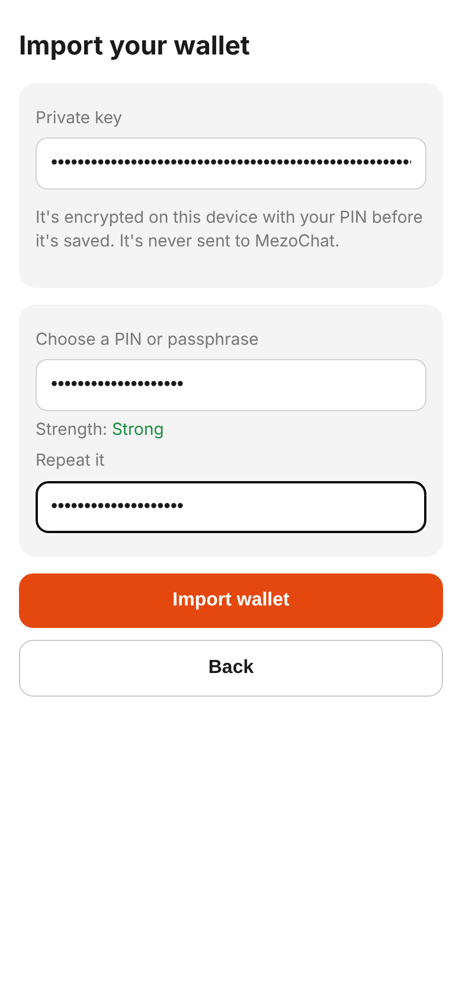
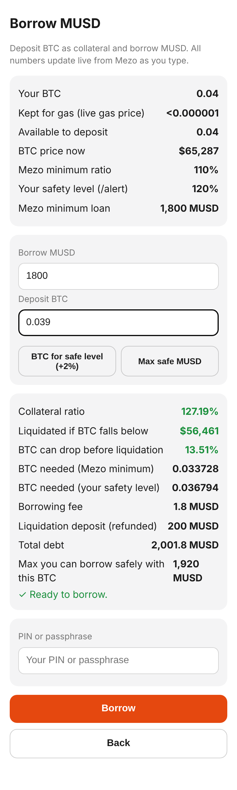
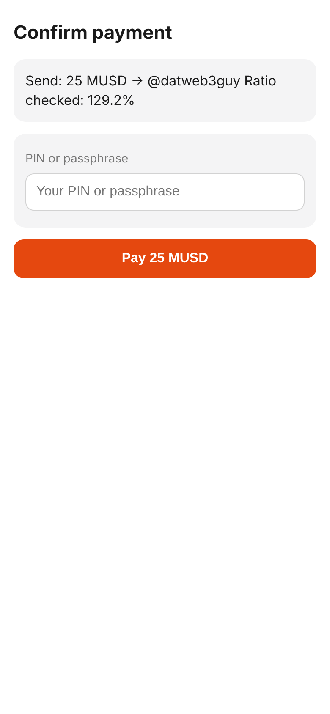
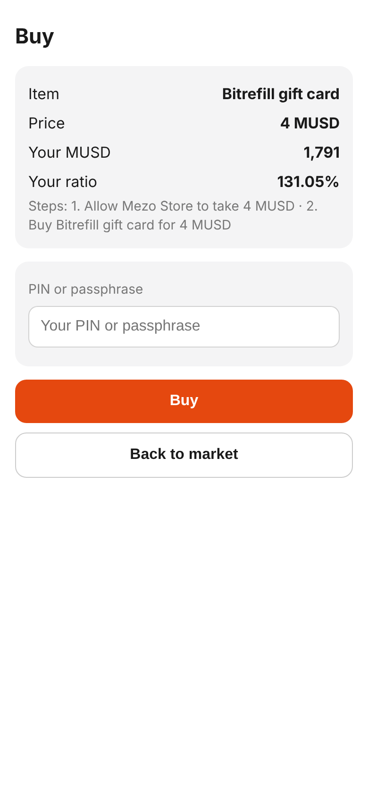
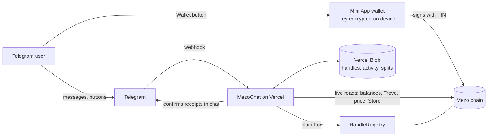

<p align="center">
  
</p>

<h1 align="center">MezoChat</h1>

<p align="center">
  <b>Your MUSD bank, inside Telegram.</b><br>
  Borrow against Bitcoin, pay anyone by @username, split bills, schedule protected payments and shop with MUSD, all in one chat.
</p>

<p align="center">
  <a href="https://t.me/MezoChat_Bot"><b>▶ Open @MezoChat_Bot</b></a> ·
  <a href="PRODUCT.md"><b>What is MezoChat?</b></a> ·
  <a href="https://pay.mezochat.xyz/health">pay.mezochat.xyz</a> ·
  <a href="https://explorer.test.mezo.org/address/0xd5c172f90799670de5f05b7506f13d977eccc6b5">On-chain registry</a>
</p>

<p align="center">
  
  
  
  
  
</p>

<p align="center">
  
  
  
</p>

---

## ✨ MezoChat in one minute

MezoChat turns Telegram into a full Bitcoin-backed bank account. Your wallet, your MUSD loan, your payments and your shopping all live in the app you already open every day.

- 💬 **Banking by message:** `/send 25 to @alice`, or just type *"send Alice 20 for lunch"*.
- 🏦 **Borrow MUSD against Bitcoin** with a live quote, right in the chat.
- 🛡️ **Your Bitcoin stays protected:** every payment checks your live collateral ratio first.
- 🛍️ **Spend MUSD** on Mezo Market and gift cards from thousands of brands.
- 🔐 **You own your keys:** the wallet is encrypted on your device with your PIN.

➡️ Read the full story in **[What is MezoChat?](PRODUCT.md)**

---

## 🧪 Try it in 2 minutes (free on Mezo Testnet)

1. Open **[@MezoChat_Bot](https://t.me/MezoChat_Bot)** and tap **Start**.
2. Tap **✨ Create or import wallet in Telegram**, then **Create a new wallet**, and pick a PIN or passphrase. Claim your @handle.
3. Send **`/faucet`** and grab free test BTC.
4. Send **`/borrow`**, enter `1800` MUSD, tap **BTC for safe level** and confirm with your PIN. Your MUSD arrives in seconds.
5. Explore:

| Try this | What happens |
|---|---|
| `/balance` · `/health` | Your wallet and live loan health |
| `/send 5 to @datweb3guy` | Pay anyone by handle, with an on-chain receipt |
| `/split 30 with @friend` | Split a bill and track who has paid |
| `/pay 10 to @friend on the 1st if ratio > 160` | A recurring payment protected by your ratio |
| `/buy` | Shop Mezo Market with MUSD |
| `/giftcard test` | A gift card with the code delivered in chat |
| `/loan` | Add BTC, repay or close your loan |
| *"send my friend 2 for coffee"* | Plain language works too |

---

## 🚀 Features

### 👛 A wallet that lives in Telegram

Tap **Wallet** to create a new wallet or import yours. Your key is encrypted on your device with your PIN or passphrase (PBKDF2, 600,000 rounds, AES-GCM) and kept in your Telegram cloud. MezoChat never sees it. MetaMask, Trust, Coinbase, OKX and any wallet browser connect too.

<p align="center">
  
  
  
</p>

### 🏦 Borrow MUSD against Bitcoin

`/borrow` builds a live quote from Mezo's own contracts as you type:
- collateral ratio
- liquidation price
- how far BTC can move before liquidation
- the BTC needed for Mezo's minimum and for your own safety level
- fee, refundable deposit and total debt

One-tap helpers fill in safe amounts. MezoChat tests the exact transaction against Mezo before you sign, then opens your Trove through `BorrowerOperations.openTrove`.

<p align="center">
  
  
</p>

### 🛡️ Manage your loan

`/loan` lets you **add BTC**, **repay MUSD** or **close the loan and get your BTC back**. Each action previews your new ratio and liquidation price, and the bot confirms in chat with a receipt.

### 💸 Pay anyone by @username

`/send 25 to @alice` works with a MezoChat handle, a Telegram @username or any wallet address. Tap **Pay**, enter your PIN, and MezoChat verifies the MUSD transfer on-chain before posting receipts to you and the recipient.

<p align="center">
  
</p>

### 🧾 Requests and bill splits

- `/request 40 from @bob` sends Bob a one-tap **Pay** button.
- `/split 120 with @alice @bob` shares the bill evenly and messages everyone their part.
- `/splits` shows who has paid, with a **Nudge** button. You get "✓ @bob paid" as shares come in, and "Split fully settled 🎉" at the end.

### 🔁 Recurring payments protected by your ratio

`/pay 800 to @landlord on the 1st if ratio > 160` schedules rent that goes out while your collateral is healthy, so your Bitcoin stays safe. `/recurring` lists them, with one-tap cancel.

### 🛍️ Mezo Market inside Telegram

`/buy` opens Mezo Market with **prices and stock read live from Mezo's on-chain Store contract**: Bitrefill gift cards and Mezo-edition Ledger wallets, with new products appearing automatically. Pick an item and pay with your PIN. MezoChat checks stock, per-person limits, your MUSD balance and your ratio, then approves MUSD and calls `order(productId)`. Your receipt comes with a **Reveal my code** button that takes you straight to your item on Mezo Market.

<p align="center">
  
  
</p>

### 🎁 Gift cards with the code in chat

`/giftcard netflix` searches Bitrefill's live catalog of thousands of brands. Pick a card and an amount, tap **Buy now**, and **the code arrives in the chat within seconds** through the [Bitrefill API](https://docs.bitrefill.com/docs/api-overview). Each purchase is logged in `/activity`.

### 🔔 Safety alerts

MezoChat watches every Trove and alerts you when your ratio approaches your own safety level (`/alert 160`), with an urgent heads-up near Mezo's liquidation line, read live from the protocol. Checks run every 3 hours.

### ⛓️ On-chain @handles

Handles live in our `HandleRegistry` contract on Mezo, so anyone can verify who a handle pays (`/whois @alice`). Reconnect from any device and your handle is restored from the chain. Every handle stays with the wallet that registered it.

### 🤖 Plain-language banking

Type the way you talk: *"yo send bob twenty for lunch"* becomes `send 20 to @bob`. The AI maps messages onto MezoChat's commands, and every action keeps its confirmation and safety checks.

---

## ⛓️ Proven on-chain

Every core flow has been run end to end through the MezoChat Mini App on Mezo Testnet:

| Flow | Transaction |
|---|---|
| Borrow 1,800 MUSD (open Trove) | [`0x1870d4e2…2dd57`](https://explorer.test.mezo.org/tx/0x1870d4e26b05963476d5326f94658c97c19772da6060236aef343ad92d52dd57) |
| Add BTC to the loan | [`0xad676b2f…0eac0f`](https://explorer.test.mezo.org/tx/0xad676b2f0c88c2381c86aec512451e70b7dfdef2be20033dafaae4821a0eac0f) |
| Mezo Market purchase (Store order #609) | [`0x15095f35…cf83ec4`](https://explorer.test.mezo.org/tx/0x15095f35288455690aceae7a3e65a3f8816c90f8f2afa0dda8c274bd4cf83ec4) |
| Repay MUSD | [`0x2f2531b2…bf15dc`](https://explorer.test.mezo.org/tx/0x2f2531b2bb17d984fe93f66a3d7f2a865648843d80cf8bc37bf7ea50bfbf15dc) |
| Send MUSD from the Telegram wallet | [`0xec41d08e…1c1a2`](https://explorer.test.mezo.org/tx/0xec41d08e7f0044a7a30359e02981381bf0e9e42824286238101519c875a1c1a2) |
| Register a @handle on-chain | [`0xb7804bc4…166e4`](https://explorer.test.mezo.org/tx/0xb7804bc4e2bad02951e37da54cfc6127db9811a8a64678e59654df0cbc8166e4) |

---

## 💬 Commands

Type `/` in the chat for the menu, or just write a sentence.

| Command | What it does |
|---|---|
| `/wallet` | Open your MezoChat wallet |
| `/borrow` | Borrow MUSD against BTC with a live quote |
| `/loan` | Add BTC, repay MUSD or close your loan |
| `/balance` | MUSD, BTC, MEZO and Trove ratio |
| `/health` | Collateral, debt, BTC price and ratio |
| `/send` | `/send 25 to @alice` or `/send 25 to 0x…` |
| `/request` | `/request 40 from @bob` |
| `/split` | `/split 120 with @alice @bob` |
| `/splits` | Who has paid, with nudges |
| `/pay` | `/pay 800 to @landlord on the 1st if ratio > 160` |
| `/recurring` | Your recurring payments, with one-tap cancel |
| `/buy` | Mezo Market, paid in MUSD |
| `/giftcard` | `/giftcard netflix`, with the code delivered in chat |
| `/activity` | Your recent receipts |
| `/alert` | `/alert 160` sets your safety level |
| `/whois` | `/whois @alice` shows the wallet and on-chain status |
| `/faucet` | Free test BTC and how to borrow MUSD |
| `/connect` | Link another wallet |

Every action ends with a receipt:

```
✓ Send
Amount: 25 MUSD
To/From: @alice
Ratio at time: 187%
Tx: 0x…
```

---

## 🧩 How it works



1. **Chat:** Telegram delivers each message to MezoChat's secured webhook. Commands and plain sentences both work.
2. **Safety gate:** before any spend, MezoChat reads your live Trove ratio (`TroveManager.getCurrentICR` with `PriceFeed.fetchPrice`) and compares it to your safety level.
3. **Signing:** payments, borrowing and purchases open the Mini App. Your PIN unlocks your key on your device, and the transaction is signed right there. External wallets sign on MezoChat's wallet page.
4. **Confirmation:** MezoChat waits for the receipt, verifies the MUSD `Transfer` log, and posts the receipt in chat.
5. **Identity:** every Mini App request is verified with Telegram's signed `initData`, and wallets are linked by signature.

### Mezo contracts

| Contract | Mezo Testnet |
|---|---|
| MUSD | `0x118917a40FAF1CD7a13dB0Ef56C86De7973Ac503` |
| TroveManager | `0xE47c80e8c23f6B4A1aE41c34837a0599D5D16bb0` |
| BorrowerOperations | `0xCdF7028ceAB81fA0C6971208e83fa7872994beE5` |
| PriceFeed | `0x86bCF0841622a5dAC14A313a15f96A95421b9366` |
| HintHelpers | `0x4e4cBA3779d56386ED43631b4dCD6d8EacEcBCF6` |
| SortedTroves | `0x722E4D24FD6Ff8b0AC679450F3D91294607268fA` |
| Mezo Store (Market) | `0xBaeB52D7f812b7C2D109aAe7e50d1BabF2759fcE` |
| **HandleRegistry** (MezoChat) | [`0xd5c172f90799670de5f05b7506f13d977eccc6b5`](https://explorer.test.mezo.org/address/0xd5c172f90799670de5f05b7506f13d977eccc6b5) |

MezoChat also ships with the Mezo Mainnet configuration, including the mainnet Mezo Store (`0xb6881e8b21a3cd6d23c4f90724e26e35bb8980be`), which we located from its on-chain `OrderPlaced` events ([`scripts/find-store.ts`](scripts/find-store.ts)).

---

## 🔐 Security

- **Non-custodial:** keys are created and encrypted in the Mini App (PBKDF2 600k + AES-GCM) and stored in Telegram CloudStorage. The server never receives a key or PIN.
- **Verified identity:** Telegram `initData` is checked by HMAC on every Mini App call, and wallets are linked with signed messages.
- **One-time links:** signing links are single-use and expire after 30 minutes.
- **Verified payments:** payments come from the linked wallet, and receipts are posted once the on-chain `Transfer` log matches.
- **Pre-flight checks:** borrow, loan and market transactions are simulated against Mezo's contracts before you sign.
- **Live protocol data:** liquidation lines, prices, fees, stock and gas are read from Mezo in real time.
- **Secured endpoints:** Telegram's webhook uses a secret token, and storage uses private Vercel Blob with conditional writes.

---

## 🛠️ Tech stack

| Area | Built with |
|---|---|
| Bot | TypeScript, [grammY](https://grammy.dev), Telegram webhook + Mini App |
| Chain | [viem](https://viem.sh), Mezo RPC, Mezo MUSD contracts |
| Wallet | Web Crypto (PBKDF2 / AES-GCM), Telegram CloudStorage |
| AI | OpenAI (`gpt-4o-mini`), mapped onto MezoChat commands |
| Contract | Solidity 0.8.24 (`HandleRegistry`) |
| Gift cards | Mezo Store contract and the Bitrefill API |
| Hosting | Vercel Functions (Build Output API), Vercel Blob, Vercel Cron + GitHub Actions |

### Project structure

```
src/
  bot/         Telegram handlers, slash menu, onboarding, scheduler
  agent/       command parser, safety gate, AI translator
  commands/    balance, send, split, recurring, market…
  mezo/        chain client, borrowing, loans, Mezo Market, gift cards, registry
  mini/        the Telegram wallet (Mini App)
  web/         API, wallet page, Telegram initData verification
  registry/    storage (local file or Vercel Blob)
  vercel.ts    Vercel function entry (webhook, cron, API)
contracts/     HandleRegistry.sol + ABI
scripts/       build, deploy and end-to-end checks
docs/          screenshots and submission
```

Product docs: [What is MezoChat?](PRODUCT.md) · [Architecture](ARCHITECTURE.md) · [Orders](ORDERS.md) · [Agent prompt](AGENTIC_PROMPT.md) · [Resources](RESOURCES.md)

---

## 🧑‍💻 Run it yourself

```bash
npm install
TELEGRAM_BOT_TOKEN=... npm start     # bot + web server on :3000
npm test                              # unit tests
npm run vercel-build                  # Vercel build output
```

| Variable | Purpose |
|---|---|
| `TELEGRAM_BOT_TOKEN` | Your bot token from @BotFather |
| `MEZO_NETWORK` | `testnet` (default) or `mainnet` |
| `PUBLIC_URL` | Your https URL, which turns on the Telegram wallet and in-chat signing |
| `OPENAI_API_KEY` | Plain-language understanding |
| `REGISTRY_ADDRESS` / `PRIVATE_KEY` | On-chain handle registry and its relayer |
| `BITREFILL_API_KEY` | Gift cards with codes in chat |
| `TELEGRAM_WEBHOOK_SECRET` / `CRON_SECRET` | Webhook and setup secrets |
| `BLOB_READ_WRITE_TOKEN` | Vercel Blob storage |

**Deploy to Vercel:** connect the repo, set the build command to `npm run vercel-build`, add the variables, then `POST /api/setup` once with `Authorization: Bearer $CRON_SECRET` to register the webhook and menu.

**End-to-end checks on Mezo Testnet:**

```bash
E2E_KEY=0x… npx tsx scripts/real-e2e.ts out        # borrow → add BTC → Mezo Market → repay
E2E_KEY=0x… npx tsx scripts/real-pay-e2e.ts 0x… 5   # Telegram wallet payment
npx tsx scripts/market-quote-check.ts                # live Mezo Market catalog
```

---

## 🌱 What's next

- 👥 **Group chats:** split and settle bills inside group conversations.
- 🏪 **More to spend on:** new Mezo Market partners and brands as they launch.
- 🌍 **More languages** for MezoChat's plain-language banking.

---

<p align="center">Built for the <b>Mezo Buildathon</b>, Access & Distribution track.<br><b>MezoChat</b>: Bitcoin-backed money, as easy as sending a message.</p>
